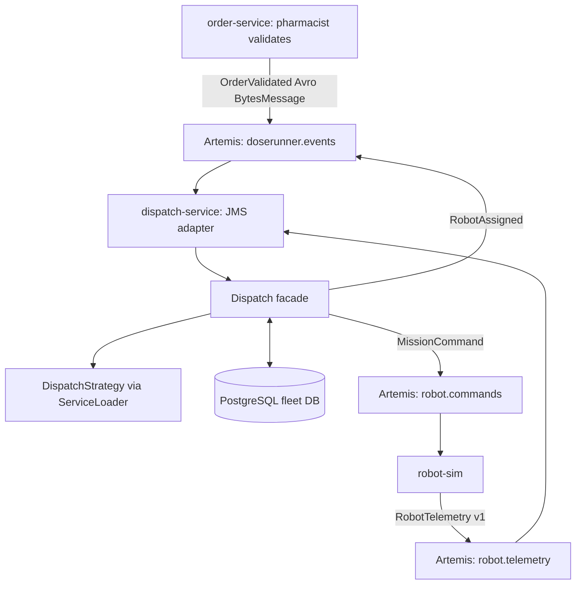
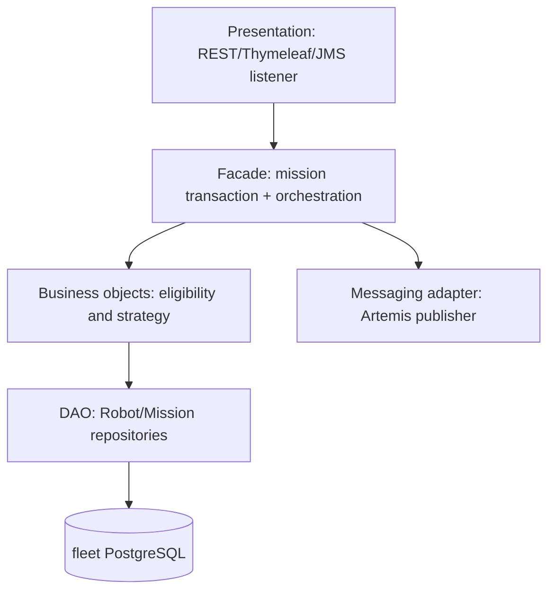

# DoseRunner — Gueddes architecture slice

**Status:** Week 1 implementation guide; reconcile with the actual Day 2 code before coding.
**Scope:** dispatch-service, Artemis, robot-sim, ROSJava-facing RobotLink.
**Primary requirements:** `docs/PRODUCT.md` if present, frozen contracts, and `docs/NOTION_WEEK1_GUEDDES.md`.

## Runtime relationships

`RobotLink` is a separate pure-JMS client interface for the ROSJava teammate, **not** a dependency of Spring controllers or the simulator. It must use the agreed messaging contracts and support the Java 11 runtime used by Knani.

## Course pyramid in dispatch-service

Exact package names are **not specified here**; follow the existing project's `pres`, `facade`, `bo`, `dao` conventions and ArchUnit rules.

## Responsibilities and expected behavior

| Piece | Week 1 responsibility | Evidence |
|---|---|---|
| `Robot`, `Mission` | Persist robots, missions, and three demo robots via Flyway | PostgreSQL Testcontainers migration/query test |
| `DispatchStrategy` | Select nearest *eligible idle* robot through Java `ServiceLoader` | Unit tests, including tie/no-eligible cases where behavior is specified |
| Dispatch facade | Coordinate selection and mission persistence in a local transaction | Deterministic facade tests; duplicate-delivery handling defined |
| `@JmsListener` | Decode `OrderValidated`, preserve IDs/trace headers, delegate to facade | Artemis Testcontainers integration test |
| Publisher | Emit `RobotAssigned` and `MissionCommand` using frozen Avro schemas | Decode produced messages with shared codec |
| Artemis broker config | Existing addresses/queues, 3 failed deliveries, delayed retry multiplier, DLQ | Broker configuration + poison-message DLQ test |
| `robot-sim` | Consume commands, simulate 1 cell/s, publish `RobotTelemetry` v1, no DB | Observable sequence of telemetry positions |
| `RobotLink` | Spring-free JMS access for Knani, Java 11-compatible artifacts | Java 11 compilation/runtime compatibility proof |
| Fleet UI | Thymeleaf robot/mission view, 2-second page refresh | Manual or UI test with changing positions |

## Message flow and semantics

1. B publishes a **frozen-contract** `OrderValidated` event on `doserunner.events` (multicast).
2. C's listener validates/decodes it using the shared Day 2 Avro codec; avoid incompatible alternate encodings.
3. C003 serializes assignment through stable full-fleet robot-row locks inside the facade transaction, refreshes robot state and checks order history after locking. Existing ASSIGNED missions are returned; terminal-only history rejects implicit reassignment. No eligible robot returns an empty result without writes and permits a later retry. These rules were approved on 2026-11-21. Full-fleet locking limits throughput; see `dispatch-service/README.md`. Durable eventId deduplication and DB/message publication consistency remain for C005.
4. The strategy selects an eligible idle robot; the facade persists the mission and robot changes within its transaction.
5. C emits `RobotAssigned` to the event address and `MissionCommand` to `robot.commands` (anycast), setting `JMSXGroupID=robotId`.
6. The simulator receives commands intended for it, moves over waypoints, and publishes telemetry on `robot.telemetry` (multicast).
7. C can consume telemetry and update fleet state for the 2-second-refresh dashboard.

Important: `JMSXGroupID` groups messages on a consumer for **ordering**; it does not independently route a message to the intended robot when multiple robot consumers share a queue. Agree on robot-specific targeting with Knani before choosing queues/selectors/filters. Do not claim exactly-once processing from Artemis defaults.

## Explicit unknowns (do not silently decide)

- Coordinates and distance metric; whether obstacles/waypoints are defined in Day 2 contracts.
- Battery eligibility threshold, robot/mission statuses and transition constraints.
- Mission command targeting per robot beyond message grouping.
- Durable event/message decoding (writer fingerprints), event ID deduplication, and DB/message consistency after a crash.
- Error path when no robot is eligible and the event's correct acknowledgment/redelivery policy.
- Exact contracts for the RobotLink Java 11-generated class artifact.

Week 1 goal is a demonstrable, tested vertical slice. Timeout sagas, native route A*, gRPC, full custody handoffs, Istio, and broker high availability are not authorized additions to this Week 1 implementation slice.

## C005 approved implementation — 2026-11-22

The previously open C005 decisions were explicitly resolved by Wassim. The
pharmacy defaults to configurable (0,0); a replaceable Manhattan route walks X
then Y at one cell/second. Paths include pharmacy, command waypoints omit it;
robot-to-pharmacy travel is excluded. This is the approved Week 1 interpretation
of the frozen schema's future libroute wording; schemas are unchanged.

The presentation listener calls `OrderValidatedFacade`, which owns the database
transaction and reuses C003 `DispatchFacade` unchanged. Durable receipt hashes,
per-robot sequence counters and one immutable outbox pair per mission commit
with the mission/BUSY update. A database-serialized `OutboxRelay` publishes via
the JMS adapter and records completion. Scheduling invokes that facade; no
transaction boundary is added to presentation or business objects.

All C005 processing/relays acquire one database coordination row before the
existing fleet-lock protocol. This is a deliberately serialized Week 1 design.
The database and broker still have separate commits; stored payloads and stable
Artemis duplicate IDs support retry, bounded by the finite duplicate cache.
No exactly-once execution is claimed. C006 must deduplicate missionId/seq.
No eligible robot rolls back and can reach DLQ even for a valid order; manual
single-message replay is required after capacity returns. Synthetic compartment
mappings are not controlled-medication enforcement.

The repository queue filter now selects OrderValidated; the live queue is not
changed. A separately authorized in-place rollout must preserve existing data.
See dispatch-service/README.md for settings, failure windows, replay, tests and
future C006/C009 dependencies. Earlier unresolved-item lists describe the
pre-C005 baseline; these explicit decisions supersede them for this slice.
